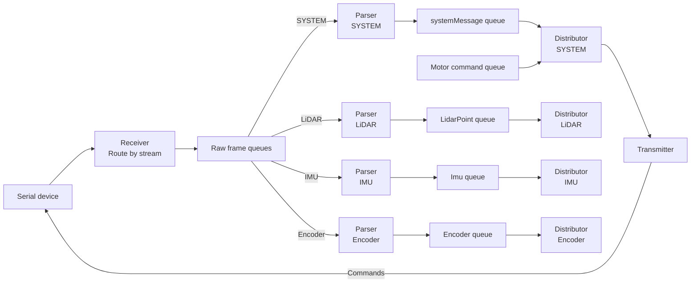
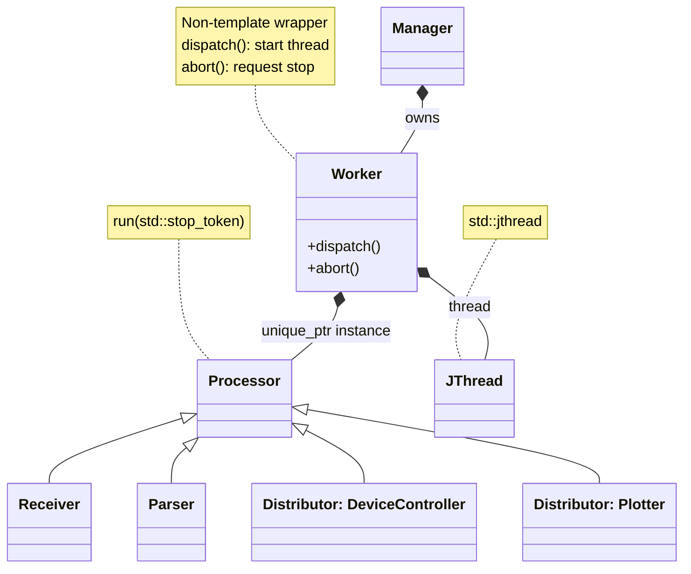
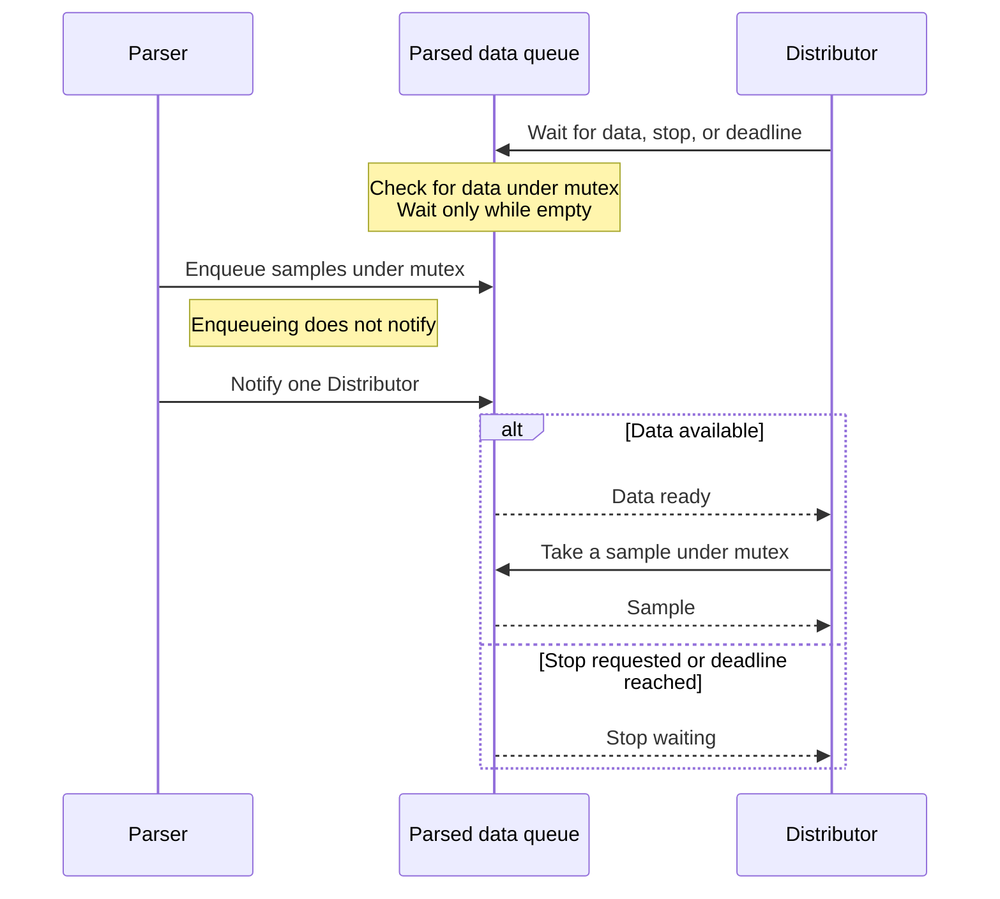
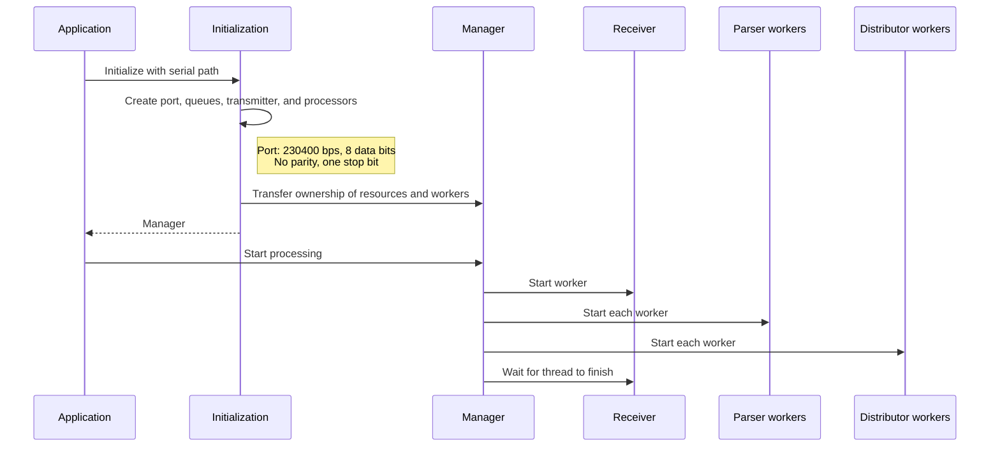
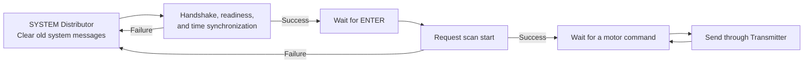
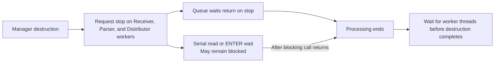

# Architecture

Current implementation. [Typed pipelines](typed-pipelines.md) are a proposal.
Host parsing: [frame.md](frame.md).
Wire format and payloads: [sensor-echo Frame Format](https://github.com/kei185/sensor-echo/blob/main/docs/frame.md).

## Data flow

SYSTEM groups device status messages and command acknowledgements.

| Distributor | Current behavior                               |
| ----------- | ---------------------------------------------- |
| SYSTEM      | Runs device startup and the motor command loop |
| LiDAR       | Drains the queue; plotting is disabled         |
| IMU         | Plots raw acceleration on three axes           |
| Encoder     | Drains the queue                               |

## Ownership

| Manager member   | Owned resource                | Used by                                 |
| ---------------- | ----------------------------- | --------------------------------------- |
| `port`           | One Port                      | Receiver reads; Transmitter writes      |
| `frameStreams`   | Map of raw frame queues       | Receiver and Parser                     |
| `dataStreams`    | Map of parsed data queues     | Parser and Distributor                  |
| `directiveQueue` | Queue of MotorCommand         | Command producer and SYSTEM Distributor |
| `transmitter`    | One Transmitter               | SYSTEM Distributor                      |
| `receiverWorker` | Receiver processor and thread | Serial RX                               |
| `parsers`        | Map of Parser workers         | One per stream                          |
| `distributors`   | Map of Distributor workers    | One per stream                          |

Parsed queues share a common base class. Each processor borrows a queue of its
concrete data type.

## Workers

Starting or stopping a worker fails if its processor is missing.

## Queue synchronization

| Stage                                  | Empty-queue behavior                           |
| -------------------------------------- | ---------------------------------------------- |
| Parser: SYSTEM, IMU, Encoder           | Wait for Receiver notification or stop         |
| Parser: LiDAR                          | Poll; Receiver does not notify it              |
| Distributor: all streams               | Wait for Parser notification or stop           |
| SYSTEM Distributor: motor command loop | Wait for command-producer notification or stop |

## Initialization and execution

## Host protocol

Frame exchanges and firmware recovery:
[sensor-echo Protocol](https://github.com/kei185/sensor-echo/blob/main/docs/protocol.md).

Startup retries continue until stopped. Command ACKs, READY, and TIME REPORT
each have a 3-second wait limit. Other system messages are consumed and logged;
STARTUP FAILED ends a READY or TIME REPORT wait with an error.

The motor command loop does not convert velocity, clamp values, or wait for a
motor ACK. The current main does not produce motor commands.

## Shutdown and limits

- Queues have no size limit or backpressure.
- Receiver I/O failures are logged and terminate the process.
- A SYSTEM Distributor startup retry does not reset the MCU or fully recover an active firmware session.
