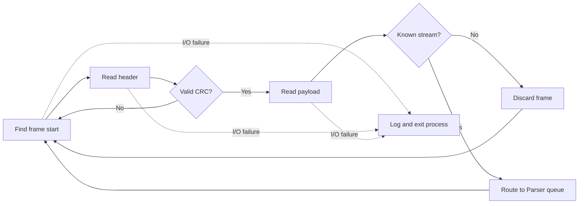
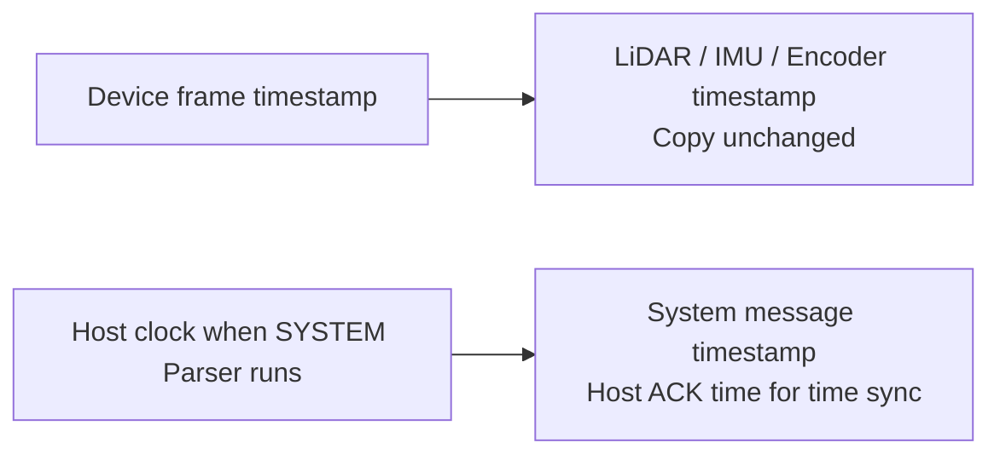
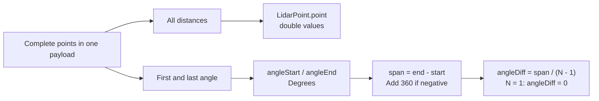
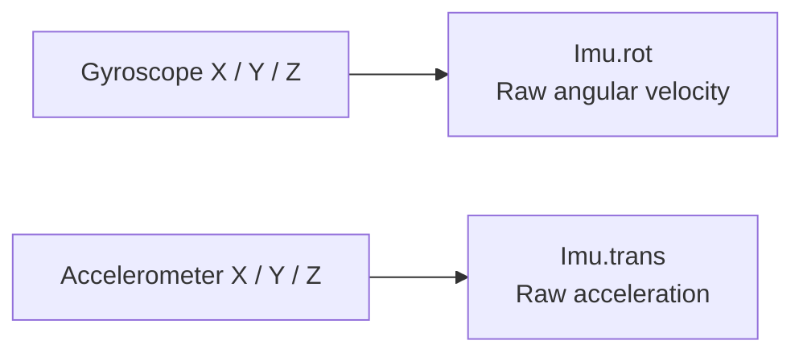
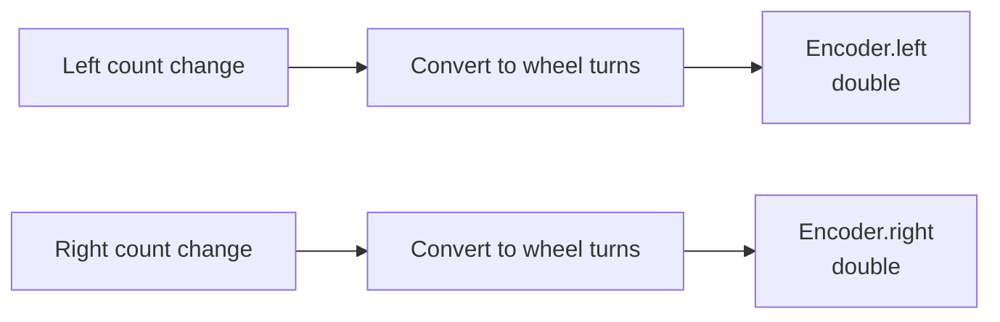

# Frame Payload Parsing

Wire format, payload fields, and units:
[sensor-echo Frame Format](https://github.com/kei185/sensor-echo/blob/main/docs/frame.md).
This document covers host parsing. Worker flow: [architecture.md](architecture.md).

## Receiver validation



## Parser behavior

| Parser | Payload handling |
| --- | --- |
| SYSTEM | Keep the message text and type; use the host parsing time |
| LiDAR | Decode every complete point; ignore trailing bytes of an incomplete point |
| IMU | Decode the first sample; ignore extra bytes |
| Encoder | Decode the first sample; ignore extra bytes |

A sensor payload too short for one point or sample produces no parsed data.
The Parser continues with the next frame.

### Timestamps



The SYSTEM timestamp is not captured directly by the Receiver's serial read.
Queue delay can affect it.

### LiDAR



Intermediate encoded angles are not retained. Reconstructing them from the
start angle and angle step, collecting a full rotation, and converting to Cartesian
coordinates are left to the Distributor or application.

### IMU



The Parser does not apply sensitivity or integrate the readings.
The field names do not imply orientation or position.

### Encoder



The Distributor or application can calculate speed from successive timestamps:

```text
elapsed_seconds = (timestamp_now - timestamp_previous) / 1000.0
wheel_rev_per_second = wheel_rotation_change / elapsed_seconds
wheel_metres_per_second = wheel_rev_per_second * wheel_circumference
```

The elapsed time must be positive.
