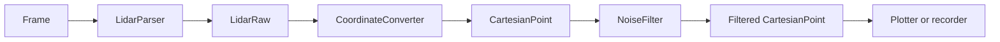
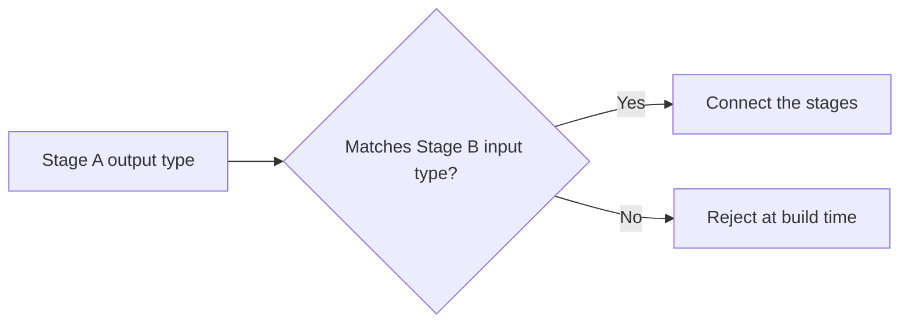
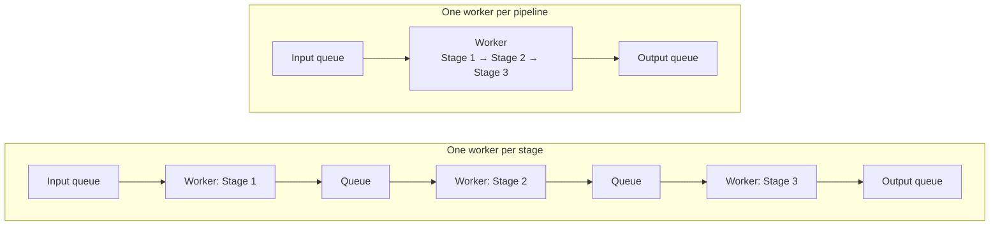
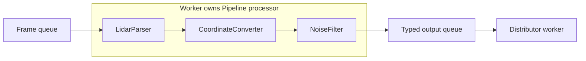

# Typed Transformation Pipelines

Design proposal, not the current implementation. Example stage types are
placeholders. Current queues and workers: [architecture.md](architecture.md).

## Stages

Each stage has a declared input type and output type.

## Compile-time composition

The stage order is fixed at build time. Every pair of adjacent stages must pass
this check:

## Execution models

| Model | Benefit | Cost |
| --- | --- | --- |
| One worker per pipeline | Fewer queue operations and synchronization points | A slow stage delays the whole pipeline |
| One worker per stage | Stages can run concurrently and buffer short bursts | More synchronization, buffer limits, and shutdown rules |

Start with one worker per pipeline. Add intermediate queues only when
measurement shows a need for independent stage execution.

## Integration with Worker

## Runtime composition

Runtime composition allows stages to be added or removed while the application
runs. Connections must be checked at runtime, with extra data dispatch and memory
management costs. Use it only when runtime reconfiguration is required.
